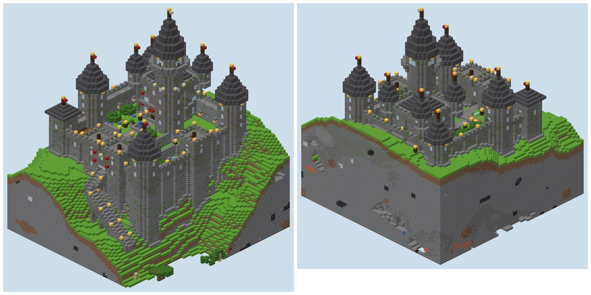
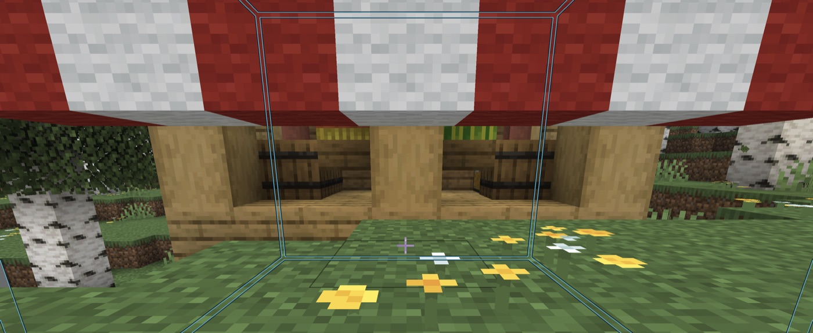
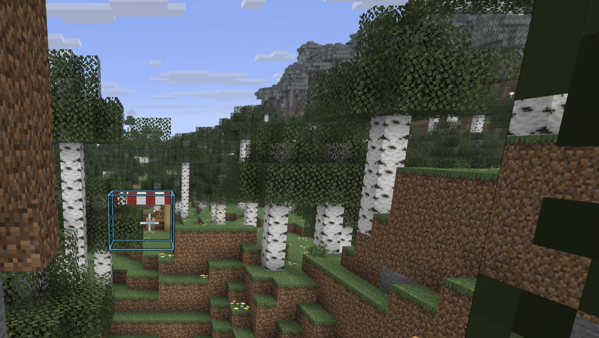
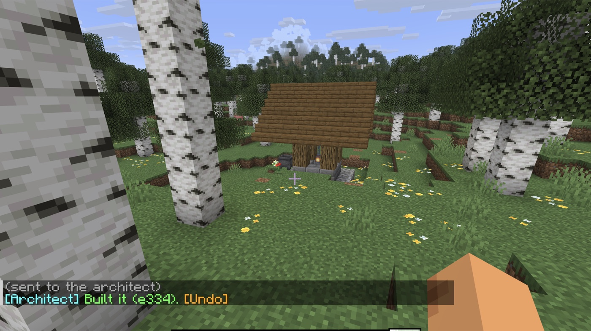

# mc-architect

A self-hosted Minecraft server kit for builders: Paper with WorldEdit, survival homes and `/tpa`, and an
optional AI architect you can ask for a build from inside the game.



## The architect

Stand somewhere and ask in chat:

```
/arc a small wooden market stall with a striped awning
```

About ten seconds later the design appears in front of you as a **preview only you can see**. The world
hasn't changed yet, and a glowing frame shows exactly where it goes, even from across the valley.

| Up close | From afar |
|---|---|
|  |  |

Then:
- `/arc make the awning blue`: it changes the design and shows it again
- `/arc yes`: builds exactly what you saw
- `/arc no`: drops it
- `/arc undo`: takes your last build back, block for block



**How it works.** `/arc` goes from the server plugin to a small program on your machine. That program
asks Claude to design the build, using a Python building toolkit. The preview is sent to your screen
only. Yes, no and undo are handled instantly, without AI.

## Also in the box
- **The server:** Paper 26.3 + WorldEdit in Docker. Every download is pinned and hash-checked, and the
  ports are private until you open them.
- **For players (no op needed):** `/sethome`, `/home`, and `/tpa` / `/tpahere` with clickable Accept and Deny.
- **For tinkerers:** `./mc.py`, a command line to read terrain, place plans, render pictures, audit
  builds (floating blocks, dark rooms, doors you can't reach) and undo anything.
- **For AI people:** eval suites that grade builds by code and by judges, plus scripted `/arc` conversations.

## Quick start
You need Docker, Python 3 and Minecraft Java 26.3.
```bash
python3 scripts/deps.py stage linux-aarch64   # or linux-x64 on Intel/AMD
docker compose build && scripts/build-plugin.sh
echo "eula=true" > server/eula.txt            # after reading the Minecraft EULA: https://aka.ms/MinecraftEULA
docker compose up -d && ./mc.py doctor
```
The whitelist is on, so let yourself in and make yourself an operator, then join `localhost`:
```bash
./mc.py cmd "whitelist add <your name>" && ./mc.py cmd "op <your name>"
```

**To turn on the architect** (needs the [Claude Code](https://claude.com/claude-code) CLI, signed in):
```bash
./mc.py architect serve
```
Leave it running while you play; `/arc` works for operators.

## Roadmap
- **Run it on your own server:** a step-by-step hosting guide (a small VPS, backups, a private link for the
  architect). The plan is in [hosting.md](docs/hosting.md).
- **Bigger builds:** whole districts and cities, and terraforming (rivers, hills, forests).
- **Friends using the architect,** with per-player limits.
- **More in-game tests:** a bot player that checks previews and builds automatically.

## More
[How the architect works](docs/architect.md) · [How the evals work](docs/evals.md) ·
[Roadmap](docs/roadmap.md) · [Hosting (planned)](docs/hosting.md) · [For Claude Code](CLAUDE.md)
